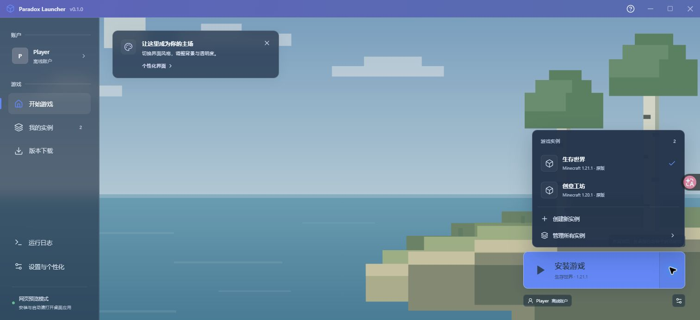
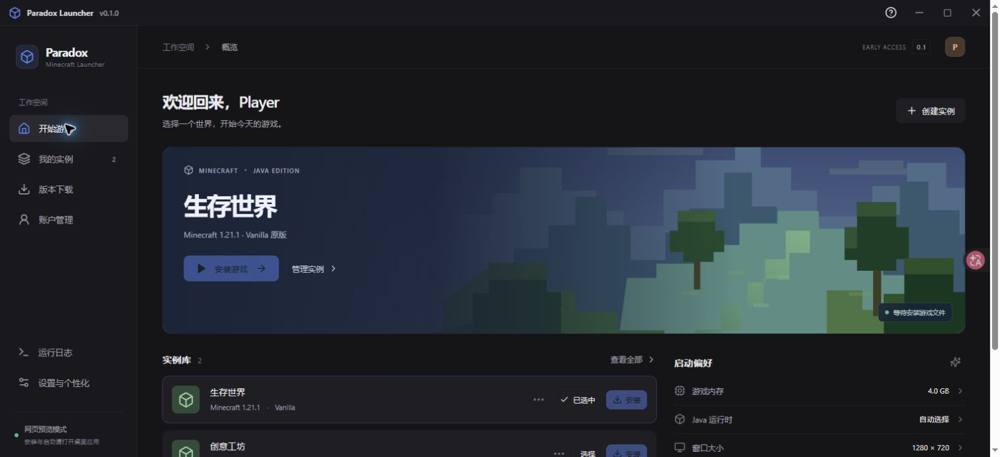

# Paradox Launcher

一个基于 **Rust + Elemental SDK** 的 Minecraft 桌面启动器。前端使用 **Tauri 2、React 19、TypeScript**，当前先交付 `v0.1.0` 基础框架测试版，收敛反馈后再推进 v0.2。

## 当前能力

- 两种可切换的界面：默认「沉浸式」采用全窗口背景、透明侧栏、紫蓝标题栏与右下启动区；「现代工作台」保留卡片式首页、实例库与启动偏好。
- 首页、我的实例、版本下载、账户管理、设置、运行日志共六页；两种样式共用相同数据与操作。
- 实例创建、重命名、切换与本地配置持久化；初次启动不注入演示实例。
- 通过 Elemental 获取真实 Mojang 版本目录、扫描本地安装、安装 / 修复 Vanilla。
- 原版离线启动接口、兼容 Java 自动选择、游戏日志流与停止进程。
- 深色 / 浅色 / 跟随系统、强调色、自定义颜色、85–120% 界面缩放、圆角、紧凑侧栏、背景开关、减少动效。
- 沉浸式背景模糊、遮罩强度与侧栏不透明度；目前背景为本地占位 SVG 和 CSS 图层，后续可以替换素材。
- 自绘标题栏的窗口控制、Base UI 对话框与实例菜单、Sonner 通知，以及可见键盘焦点。
- 游戏目录、Java 路径、最小 / 最大内存、游戏窗口分辨率、JVM / 游戏附加参数、离线用户名、快照显示。
- Git、依赖锁文件、格式规范、GitHub Actions、分层架构与开发路线。

Microsoft 登录、模组加载器、整合包、Java 自动下载、安装取消 / 字节进度、系统安装包尚未开放，详见 [ROADMAP.md](ROADMAP.md)。
完整 Minecraft 安装与启动流程仍需端到端验收，当前验证范围见 [验证记录](docs/VERIFICATION.md)。

在「设置与个性化 → 外观与体验」选择界面风格。外观修改在设置页即时预览，点击「保存设置」后持久生效；「还原修改」恢复已保存的值。

## Windows 测试版

测试文件位置：`releases/v0.1.0/Paradox-Launcher-0.1.0-windows-x64.exe`。构建与校验状态见 [验证记录](docs/VERIFICATION.md)，操作步骤见 [v0.1 测试指南](docs/TESTING-v0.1.md)。

发布版内嵌前端，不需要 Rust、Node.js、npm 或 Vite 服务。Windows 需要 WebView2 Runtime；安装游戏需要网络，启动 Minecraft 需要对应版本的本地 Java。

关闭启动器当前不会自动结束 Java，建议先点击「停止游戏」。完整游戏兼容矩阵、原生渲染和高 DPI 尚未验收。

## 开发启动

环境：Rust **1.92+**（MSVC）、Node.js **22.13+ 或 24+**、npm、Windows WebView2 Runtime。
Windows 需要 Visual Studio Build Tools 的 C++ 桌面开发组件和 Windows SDK；SDK 的 TLS 依赖需要 CMake。
本项目已在当前 Windows 环境编译与验证。Linux / macOS 的 CI 已配置，跨平台行为仍需 CI 和人工验收。

```powershell
npm ci
npm --prefix ui ci
npm run dev
```

`npm run dev` 自动启动 Vite 并运行 Tauri 桌面窗口。首次 Rust 构建需要下载依赖。
要安装游戏，在桌面窗口创建实例后使用启动区或实例列表中的安装操作；启动前需要对应版本的本地 Java。

仅查看前端：

```powershell
npm run dev:ui
```

打开 <http://127.0.0.1:1420/>。网页预览将配置保存在浏览器本地存储；目录列表为真实 Mojang 数据，安装 / 启动按钮禁用。桌面版通过 Rust 和 Elemental 执行操作。两个模式的数据分别保存。

构建可执行文件（当前关闭安装包打包）：

```powershell
npm run build -- --features tauri/custom-protocol
```

Windows 输出：`target/release/paradox-launcher.exe`。发布构建显式启用 `tauri/custom-protocol`，使用内嵌资源；不要将未启用该特性的普通 Cargo release 预编译产物当作独立测试版。

## 校验

```powershell
npm run format:check
npm run lint:ui
npm run build:ui
cargo fmt --all -- --check
cargo check --workspace --all-targets --locked
cargo clippy --workspace --all-targets --locked -- -D warnings
cargo test --workspace --all-targets --locked
```

不打开窗口、不安装游戏的 SDK 检查：

```powershell
cargo run -p paradox-launcher -- --check-catalog
cargo run -p paradox-launcher -- --inspect
```

首次以 Cargo 运行桌面 crate 前，应先执行 `npm run build:ui`。
网络目录查询不纳入常规单元测试，避免 CI 依赖 Mojang 服务。

前端由 `App` 组合页面、`useLauncher` 管理状态与操作、API adapter 处理 IPC／网页预览；复用组件与纯逻辑分别位于 `components/` 和 `lib/`。ESLint 10 执行类型相关、Promise 和 React Hooks 规则，Prettier 统一 Web 源码格式；Rust 使用 rustfmt 与 Clippy。开发约定见 [CONTRIBUTING.md](CONTRIBUTING.md)。

## 目录

```text
apps/desktop/          Tauri 宿主、IPC 命令、SDK 工作线程、进程事件
crates/launcher-core/  领域模型、配置校验 / 原子保存、Elemental 适配
ui/                   React 页面、主题变量、桌面 / 网页预览 API
assets/               原始矢量图标
vendor/               已说明原因的 SDK 依赖兼容补丁
docs/                 架构、近期计划、UI 规范、SDK 接入说明
.github/workflows/    CI
```

桌面数据默认存放于系统本地应用数据目录：Windows 为 `%LOCALAPPDATA%/ParadoxLauncher/`，
其中 `config.json` 保存设置与实例，`minecraft/` 为默认游戏根目录。
游戏文件由 Elemental 的 `Storage + Layout` 管理：`versions/<instance_key>/` 保存独立实例，
`assets/`、`libraries/` 保存共享资源。实例名称与存储键分离，重命名不会移动存档。
开发与验证时可用 `PARADOX_CONFIG` 环境变量指定独立配置文件，避免覆盖日常配置。

## 界面预览

默认沉浸式界面：



保留的现代工作台：



以上为浏览器实际渲染截图。截图中的实例是界面验证数据，初次运行不自动创建实例。
当前背景素材用于占位；原生窗口渲染验收按用户要求留到后续。

## UI 设计技能

已安装 [emilkowalski/skills](https://github.com/emilkowalski/skills/tree/2d228630ba1446365f614a108cb8252f1feda202) 的 15 个技能到当前用户的 Codex skills 目录。
界面实现参考 `emil-design-eng` 与 `ask-sonner`：使用克制的层级、短促反馈、键盘与减少动效支持。
这些技能用于开发工作流，运行启动器无需安装 Codex 技能。

## SDK 与许可

SDK 固定为 [`26673f48`](https://github.com/ElectronicWave/Elemental/tree/26673f4878882eeb94d4341bdc3dae910d3e57b7)，实际 facade crate 为 `elemental-kit 0.2.0`。
当前提交存在认证客户端类型不兼容，项目通过 [vendor/README.md](vendor/README.md) 所述的最小依赖补丁完成编译。
部分 SDK future 不是 `Send`，Tauri 宿主在后台线程内创建和驱动这些 future，UI 保持响应。

项目采用 **AGPL-3.0-only**，与 Elemental 的许可保持一致；补丁库保留原有 MIT / Apache-2.0 许可。
源码参考：[Elemental](https://github.com/ElectronicWave/Elemental)、[DeepWiki](https://deepwiki.com/ElectronicWave/Elemental)。
本次 DeepWiki 返回 429，具体接口以固定提交源码为准。

本地 Git 已使用 `main` 分支；远程仓库地址待创建后设置，不将 Elemental 上游误设为本项目 origin。

详细文档：[架构](docs/ARCHITECTURE.md) · [近期计划](docs/PLAN.md) · [UI 与自定义](docs/UI.md) · [SDK 接入](docs/ELEMENTAL.md) · [路线图](ROADMAP.md) · [验证记录](docs/VERIFICATION.md) · [v0.1 测试指南](docs/TESTING-v0.1.md)
