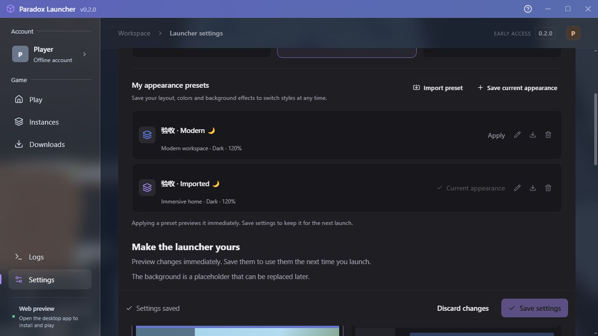

# Paradox Launcher

基于 **Rust + Elemental SDK** 的 Minecraft 桌面启动器，使用 **Tauri 2、React 19、TypeScript**。当前版本为 `v0.2.0`：原版安装、Java 管理、实例管理、双样式界面、自定义外观预设与简体中文 / English 已完成，四组游戏运行矩阵、61 项 Rust 测试与正式 release 构建已通过，可使用 Windows x64 功能测试版。

## 当前能力

- 两种界面：默认「沉浸式」使用全窗口背景、透明侧栏与右下启动区；「现代工作台」保留卡片式首页。首页、实例、下载、账户、设置和日志共六页，两种样式共用配置与任务状态。
- 自绘标题栏、自由调整窗口大小、正文独立滚动，以及融入主题的细滚动条。背景使用 CSS 图层与本地占位图片。
- 实例创建、重命名、切换、编辑与已有 Vanilla 实例导入。导入引用完整游戏根目录中的原文件；默认移除仅删除启动器记录，删除实例文件需要另行确认。
- 每实例 Java、最小 / 最大内存、分辨率、JVM 与游戏参数覆盖；未启用覆盖的项目继承全局设置。
- Elemental 真实版本目录与磁盘扫描，版本目录缓存、手动刷新、网络失败时缓存回退，并显示缓存来源与警告。
- 原版安装 / 修复下载队列，文件数、字节数与速率，取消、失败重试、校验与已有完整文件复用。
- 本地 Java 检测、可执行文件选择、版本与架构检查；Windows x64 / ARM64 可下载 Adoptium JRE，并校验下载文件与实际运行时版本。
- 原版离线启动、游戏日志流、停止游戏与异常退出提示；任务运行时关闭窗口可询问、停止任务并退出，或隐藏窗口继续任务。
- 网络超时、文件并发、重试次数、HTTP / HTTPS 代理与 Mojang 兼容镜像配置。
- 深色 / 浅色 / 跟随系统、强调色、85–120% 缩放、圆角、紧凑侧栏、背景模糊 / 遮罩 / 侧栏不透明度、减少动效；外观在设置页即时预览，保存后持久生效。
- 自定义界面预设：保存完整外观、命名、应用、重命名、移除和可移植 JSON 导入 / 导出；预设库独立于未保存的设置草稿。
- i18n：简体中文、English 与跟随系统；页面、弹窗、常用通知与状态即时切换并持久化，翻译资源随 exe 离线提供。使用及扩展说明见 [界面预设与多语言](docs/CUSTOMIZATION-I18N.md)。
- 版本化配置与原子保存、参数校验、损坏配置保护、Git 基线、依赖锁文件和质量检查。

Microsoft 登录、模组加载器、整合包、正式背景文件管理、系统安装包和自动更新按 [路线图](ROADMAP.md) 继续开发。当前账户为离线身份。

实际验证范围见 [验证记录](docs/VERIFICATION.md)：1.12.2 / Java 8、1.20.1 / Java 17、1.21.1 / Java 21、验证时最新稳定版 26.3 / Java 25 均已完成两次日志就绪与自然退出，完整资源修复检查传输量为 0。26.3 已通过原生库搜索目录兼容处理后的复验。原生 exe 已验证首页加载、键盘导航、最大化 / 还原、现代样式保存后重启恢复与 Alt+F4 正常退出。预设、双语切换、持久化、草稿隔离及 320 × 240 / 120% 缩放无页面溢出已在浏览器验收；完整原生视觉、鼠标任意尺寸拖动、高 DPI 和任务运行期间全部关闭分支继续验收。

## Windows 测试版

可执行文件为 `releases/v0.2.0/Paradox-Launcher-0.2.0-windows-x64.exe`，测试包为 `releases/Paradox-Launcher-0.2.0-windows-x64.zip`。最终 exe 已验证为 Windows x64 GUI 程序，大小 **25,362,432 字节**，SHA-256：

```text
b5d2f6027a33e640e6de66cf1e57c4e8f5b6fc33bcd3cec0311c2591cc998158
```

测试包包含 exe、许可证、构建元数据与测试说明。操作步骤见 [v0.2 测试指南](docs/TESTING-v0.2.md)，实际校验结果见 [验证记录](docs/VERIFICATION.md)。此前 v0.1 文件保留在 `releases/v0.1.0/`。

发布版内嵌前端，运行无需 Rust、Node.js 或 Vite。Windows 需要 [WebView2 Runtime](https://developer.microsoft.com/microsoft-edge/webview2/)。安装游戏需要网络，启动 Minecraft 需要与该版本匹配的 Java；可以选择本地 Java，或下载启动器管理的运行时。

游戏或下载进行中默认询问关闭行为。「隐藏窗口，继续运行任务」会在任务结束后退出，再次打开同一 exe 可唤回窗口。改变游戏根目录不会自动迁移已有文件；导入的外部实例继续引用原目录。

## 开发与构建

环境要求：Rust **1.92.0**（`rust-toolchain.toml` 与 CI 固定此版本）、Node.js **22.13+ 或 24+**、npm、Windows WebView2 Runtime。Windows 编译需要 Visual Studio Build Tools 的 C++ 桌面开发组件、Windows SDK，以及 SDK TLS 依赖所需的 CMake。

```powershell
npm ci
npm --prefix ui ci
npm run dev
```

仅前端预览使用 `npm run dev:ui`，地址为 <http://127.0.0.1:1420/>。网页模式将配置存放在浏览器本地存储，安装、启动、本地文件选择和 Java 检测仅在桌面版开放。两个模式的数据独立。

构建 Windows 可执行文件：

```powershell
npm run build -- --features tauri/custom-protocol -- --locked
```

输出为 `target/release/paradox-launcher.exe`。发布构建必须启用 `tauri/custom-protocol`，使前端资源内嵌；当前未启用系统安装包打包。

## 校验

```powershell
npm run format:check
npm run lint:ui
npm run check:i18n
npm run build:ui
cargo fmt --all -- --check
cargo check --workspace --all-targets --locked
cargo clippy --workspace --all-targets --locked -- -D warnings
cargo test --workspace --all-targets --locked
```

网络目录查询不纳入常规单元测试。只读 SDK 诊断可使用：

```powershell
cargo run -p paradox-launcher -- --check-catalog
cargo run -p paradox-launcher -- --inspect
```

游戏兼容验证工具为 `crates/launcher-core/examples/verify_mvp.rs`，会真实下载并启动游戏，使用独立目录运行，步骤见测试指南。下载故障、路径与移除保护等测试的实际结果记录在验证文档中。

当前 55 项 core 与 6 项 desktop 测试通过；翻译检查覆盖 502 个资源键和 420 处静态翻译调用。Vite 主 JavaScript 产物为 627.11 kB，构建有非阻断的体积提示。

## 项目结构与数据

```text
apps/desktop/          Tauri 宿主、IPC、下载队列、窗口与游戏进程生命周期
crates/launcher-core/  配置、实例、网络、下载、Java、目录缓存与 Elemental 适配
ui/                   React 页面、共享组件、状态 Hook、主题与 API adapter
assets/               原始矢量图标
vendor/               已说明原因的 SDK 依赖兼容补丁
docs/                 架构、计划、界面、SDK 接入与测试记录
.github/workflows/    质量检查与跨平台 CI 配置
```

桌面默认配置为 `%LOCALAPPDATA%/ParadoxLauncher/config.json`，默认游戏根目录为同目录下的 `minecraft/`。游戏根目录包含 `versions/`、`assets/`、`libraries/`；显示名称与实例存储键分离，重命名不会移动存档。启动器管理的 Java 放在配置目录旁的 `runtimes/`。

开发测试可设置 `PARADOX_CONFIG` 指向独立配置文件。该变量只改变配置位置，游戏目录需在设置中另外指定。配置加载错误时 GUI 保持可达、显示原因并拒绝写入，以保留原文件。

开发约定见 [CONTRIBUTING.md](CONTRIBUTING.md)。Git 使用 `main`，当前未设置远程；创建项目自己的仓库后再添加 `origin`。

## 界面预览

默认沉浸式界面：


保留的现代工作台：


上述截图为此前浏览器实际渲染记录，展示两种视觉风格，实例为验证数据。初次启动不会自动创建演示实例，当前背景仍为占位素材。最终原生窗口验收状态见验证记录。

v0.2 英文沉浸式界面预设列表：



中文现代工作台预设界面见 [实际浏览器截图](docs/screenshots/v0.2-presets-zh.jpg)。

## SDK、设计与许可

Elemental 固定为 [`26673f48`](https://github.com/ElectronicWave/Elemental/tree/26673f4878882eeb94d4341bdc3dae910d3e57b7)，facade crate 为 `elemental-kit 0.2.0`。认证客户端类型兼容补丁见 [vendor/README.md](vendor/README.md)。SDK 部分 future 不满足 `Send`，宿主在后台线程创建和驱动这些操作，界面保持响应。

界面开发参考已安装的 [emilkowalski/skills](https://github.com/emilkowalski/skills/tree/2d228630ba1446365f614a108cb8252f1feda202)，主要使用 `emil-design-eng` 与 `ask-sonner`。运行启动器无需安装这些技能。

项目采用 **AGPL-3.0-only**，与 Elemental 保持一致；补丁库保留 MIT / Apache-2.0 许可。源码参考：[Elemental](https://github.com/ElectronicWave/Elemental)、[DeepWiki](https://deepwiki.com/ElectronicWave/Elemental)。此前 DeepWiki 请求返回 429，接口以固定提交源码为准。

详细文档：[架构](docs/ARCHITECTURE.md) · [计划](docs/PLAN.md) · [UI 与自定义](docs/UI.md) · [SDK 接入](docs/ELEMENTAL.md) · [路线图](ROADMAP.md) · [验证记录](docs/VERIFICATION.md) · [v0.2 测试指南](docs/TESTING-v0.2.md)
