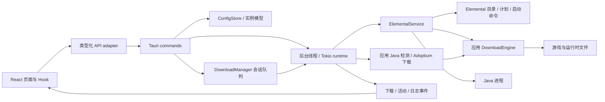

# 架构

## 技术选择

- Rust：配置与实例模型、文件 / 网络 / 下载、Java 管理、Elemental 适配与进程监督。
- Tauri 2：桌面窗口、受控 IPC 与事件流，系统 WebView 渲染前端。
- React + TypeScript + Vite：页面、共享组件、UI 状态和外观预览。
- Base UI：对话框与菜单的焦点 / 键盘 / 弹层行为；Sonner：任务与设置通知。
- i18next / react-i18next：内嵌简体中文与 English 资源、系统语言响应和界面本地化。
- Elemental：版本目录、元数据解析、资源计划、实例布局、加载与启动命令。
- JSON + tempfile：版本化配置，校验后在同一目录原子替换。

两种视觉样式使用同一领域模型与操作入口，Rust 执行实际游戏逻辑，Web 层负责交互。

## 调用关系

`crates/launcher-core/src/sdk.rs` 是游戏 SDK 的主要适配边界，将 SDK 版本、实例和资源计划转换为应用数据结构。目录缓存、下载引擎、Java 管理和实例配置独立于前端；桌面宿主负责队列、命令调度与进程生命周期。

部分 Elemental future 持有未声明 Sync 的 driver 引用，不能直接移动到需要 Send 的 Tauri executor。宿主使用 `spawn_blocking`，在工作线程内部构造 future，通过 Tokio 多线程 runtime 的 `block_on` 驱动。游戏运行期间 runtime 持续存在，以保留 stdout / stderr 的读取任务。

## 下载、网络与 Java

版本目录与安装元数据通过 `VanillaSource::with_client` 注入应用网络配置，使用官方或 Mojang 兼容镜像端点。`CatalogCache` 保存目录、获取时间与来源；过期或强制刷新时请求网络，失败时以警告回退可用缓存。

原版安装先加载或解析 `ResolvedVanillaVersion`，由 SDK planner 生成资源计划。应用 `DownloadEngine` 执行并发传输、重试、取消与 SHA / 大小校验，再调用 SDK prepare 解压原生库和验证实例。下载目标的路径与已有父目录检查拒绝越过游戏根目录。已完成文件校验后复用，取消和失败等待文件工作线程结束后才返回。

桌面 `DownloadManager` 对实例安装与 Java 下载排队，任务串行、任务内文件并发。当前最多 32 个待处理任务、100 条保留记录，按实际状态发布下载事件；重复添加同一待处理目标返回现有任务。队列历史仅在会话中保存，重启后的安装 / 修复通过文件校验恢复。

`BusyGuard` 与队列共享原子状态，阻止下载、启动和配置修改冲突；下载进行中仍可追加其他下载任务。目录查询和只读扫描独立执行。启动使用已有实例，不隐式下载安装；进程监督区分自然退出、成功停止与异常退出，停止失败继续监督并收集日志。

Java 候选来自 SDK provider、已配置路径、管理目录、环境变量、PATH 和常见目录，应用通过实际进程检查版本与架构。实例 JSON 决定所需 Java 主版本，旧元数据默认 Java 8；显式和自动选择均要求主版本及架构匹配。Adoptium JRE 下载使用同一引擎，校验归档、检查实际主版本后发布到配置目录旁的 `runtimes/`。

固定 SDK 的 26.3 原生库兼容处理只追加实际 `natives/` 到命令搜索列表，保留元数据指定的 `natives/java`。接口与补丁详情见 [ELEMENTAL.md](ELEMENTAL.md)，实际兼容矩阵见 [VERIFICATION.md](VERIFICATION.md)。

## 配置与实例

`AppConfig { schema_version, settings, profiles, active_profile, appearance_presets }` 保存全局配置、实例、当前选择与外观预设库。

- `Settings` 包括游戏、网络、关闭行为、`Appearance` 与语言偏好；新增字段通过 serde 默认值兼容旧配置。
- `Appearance.interface_style` 为 `immersive` 或 `modern`，默认沉浸式；背景效果映射 CSS 变量，素材使用本地占位图。
- `AppearancePreset` 保存 UUID、名称与完整外观；最多 32 个，名称 1–48 个 Unicode 字符，严格检查字段与 UUID 语义重复。预设 JSON 导入 / 导出只含外观，格式独立版本化。
- 新实例以 UUID 为存储键，显示名称可独立修改；安装状态来自磁盘扫描。
- `GameProfile.game_directory` 可引用外部完整游戏根目录，未指定时跟随全局根目录；修改全局目录不迁移文件。
- `ProfileOverrides` 使用 `Option<T>` 表示继承或覆盖；启用空 Java 表示自动选择，空参数清除对应全局参数。
- 配置、版本号、实例键、路径、内存和分辨率由 Rust 再次校验。元数据与链接路径也需满足文件操作边界。
- 导入只注册已有 Vanilla 实例，保留原文件；移除记录与删除实例文件分开，文件移除保护共享资源及链接。

`BaseRootLayout` 将独立实例放在 `versions/<instance_key>/`，完整根目录下的 assets / libraries 共用。未找到配置使用默认值，损坏或未来 schema 报错并保留原文件。宿主保存 `startup_error`，GUI 显示错误，相关写命令拒绝操作；修复后重启重新读取。

## 前端状态与窗口

`App.tsx` 组合窗口与页面。`useLauncher` 管理配置、活动进程、日志与操作；`useCatalog` 管理版本缓存显示，`useJava` 管理检测 / 选择，`useDownloadQueue` 管理队列订阅与任务命令，`useCloseRequest` 管理关闭请求。共享 `LauncherDialog` 统一弹窗主题、焦点与待处理状态。

设置维护独立 draft，外观即时预览，保存后更新持久配置，离开设置页不自动保存。写操作串行并使用最后确认的配置，扫描请求序号和目录检查排除过期结果。队列先订阅再读取快照，版本标记排除过期快照；Java 下载完成时合并待执行检测，避免其他选择或检查操作丢失刷新。事件在组件清理或部分失败时解除订阅。

预设库写操作只替换最后已保存配置中的 `appearance_presets`，不提交设置草稿；应用预设只更新外观 draft。语言偏好独立于预设，即时预览并随设置保存。`i18n.ts` 初始化内嵌资源、同步文档语言与 Intl locale，已知启动器状态在展示时翻译，未知 SDK 诊断和游戏日志保留原文。资源键与插值一致性由 `ui/scripts/check-locales.mjs` 在 CI 中检查。

日志最多保留最近 500 条，在内存中保存并可导出文本。现代 `HomePage` 与 `ImmersiveHome` 使用相同状态与回调。应用固定到视口，标题栏与侧栏稳定，正文 / 侧栏 / 弹窗分别按需滚动；窗口不设置应用级最小或最大尺寸。

`WindowBar` 调用 Tauri 窗口 API。任务期间关闭由宿主拦截，按保存的行为询问、取消任务并停止游戏，或隐藏继续。隐藏期间任务结束后退出，再次启动同一 exe 通过 single-instance 插件唤回；停止超时或失败保留窗口。

网页 adapter 使用独立浏览器本地存储与真实 Mojang 目录，只用于 UI 开发。安装 / 启动、Java 检测 / 下载和本地文件选择仅在桌面版执行。

## 构建、权限与范围

窗口能力只授予事件、最小化、最大化 / 还原、关闭与拖动，文件和进程通过自定义 Rust 命令处理。CSP 禁止任意远程脚本，发布前端静态资源内嵌。正式构建显式启用 `tauri/custom-protocol` 并使用 `--locked`；Rust 工具链固定为 1.92.0。构建 hook 在宿主目录执行 `../ui`，frontendDist 为 `../../ui/dist`。

ESLint 10 检查 TypeScript 类型、Promise、Hooks 与 Fast Refresh，Prettier 统一 Web 源码和文档，Rust 使用 rustfmt / Clippy。常规检查与本地真实游戏矩阵分别记录，CI 配置不代表远程平台已经通过。

当前 v0.2 开放 Vanilla 离线流程。Microsoft 凭据计划存放 OS 凭据库，账户、loader、内容与自动更新继续按 [ROADMAP.md](../ROADMAP.md) 接入。Windows 高 DPI 完整矩阵、跨平台原生桌面与系统安装包另行验收。
