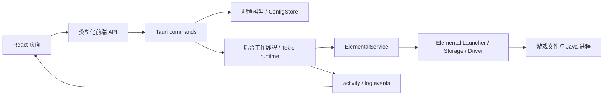

# 架构

## 技术选择

- Rust：领域模型、文件与配置、Elemental SDK、进程与异步工作。
- Tauri 2：桌面窗口、受控 IPC、事件流；系统 WebView 渲染前端。
- React + TypeScript + Vite：页面组件、UI 状态、主题预览与交互。
- Base UI：对话框与实例选择菜单的焦点、键盘和弹层行为；Sonner：任务及设置通知。
- Elemental：catalog / inspect / prepare / load / build command，与游戏资源布局。
- JSON + tempfile：版本化配置，验证后在同一目录原子替换。

用户要求现代 GUI 与较多自定义设置，因此采用 Web UI；Rust 是游戏逻辑的唯一实现位置。

## 数据与调用关系

`crates/launcher-core/src/sdk.rs` 是 SDK 类型的适配边界。前端不保存 SDK 对象，实例与版本
被转换为启动器拥有的数据结构。桌面宿主负责调度和进程管理。

Elemental 某些 future 持有未声明 `Sync` 的 Driver trait object，不能放进需要 `Send`
的 Tauri async command future。宿主使用 `spawn_blocking`，在后台线程内构造 SDK future，
通过一个 Tokio 多线程 runtime 的 `block_on` 驱动，Tokio 仍可处理下载与解压的子任务。
游戏运行期间此 runtime 保持存活，stdout / stderr 的读取任务因此不会随启动函数返回而销毁。
进程监督区分自然退出与主动停止；成功停止报告完成，停止失败继续监督进程并收集日志。

当前任务模型只允许一个安装 / 启动任务；目录查询与只读扫描可以单独执行。
`BusyGuard` 原子互斥并在退出或失败时释放。配置保存与实例创建在任务期间被拒绝，
避免运行中切换游戏目录。事件只报告实际阶段，不展示编造的下载百分比。

`apps/desktop/src/cli.rs` 提供无 GUI 的版本、帮助、版本目录与扫描诊断。窗口启动不再因配置加载失败而直接退出：宿主保留 `startup_error`，`get_config` 将错误传给前端，涉及配置的写命令被拒绝；损坏文件保持原样。修复文件后重新启动宿主即可重新读取。

## 配置与实例

`AppConfig { schema_version, settings, profiles, active_profile }`：

- `Settings` 为全局默认设置，含游戏参数与 `Appearance`。
- `Appearance.interface_style` 选择 `immersive` 或 `modern`，默认 `immersive`；新增字段通过 serde 默认值兼容旧配置。
- 背景模糊、遮罩与侧栏不透明度由配置映射到 CSS 变量，不引入远程图像依赖。
- `GameProfile` 使用 UUID 作为 `instance_key`；显示名称可独立改变。
- 安装状态来自 SDK 对磁盘的扫描，不写成永远可信的 `installed: true`。
- 版本号、目录、实例键、内存与分辨率在 Rust 再次验证。
- 未找到配置使用默认值；损坏或未来 schema 明确报错，保留原文件。
- 默认游戏资源在本地应用数据目录，用户可改为其他绝对路径。

当前 SDK BaseLayout 使用 `versions/<instance_key>` 作为独立游戏目录。
未来每实例设置将使用 `Option<T>` 覆盖全局配置，不直接重复一整份默认值。

## 前端与状态

`App.tsx` 负责窗口壳与页面组合；`pages/` 分别负责实例、下载、账户、设置和日志页面。`useLauncher` 管理 config、活动任务、日志、目录数据、通知与异步操作，`useSystemTheme` 监听系统主题。`components/` 提供基础控件、实例卡片和对话框，`lib/` 保存校验、主题变量、导航与日志导出等纯逻辑。

设置使用单独 draft，在设置页即时预览，保存后再替换持久配置。离开设置页不会自动保存。配置写入串行执行，并从最后确认的配置构造下一次更新，避免账户保存与实例选择相互覆盖。异步扫描使用请求序号和目录检查排除过期结果；事件订阅在清理或部分失败时解除。
日志最多显示 500 条；当前只在内存保存，可导出为文本。
`HomePage` 保留现代工作台，`ImmersiveHome` 提供默认沉浸式首页；两者使用相同父级状态与操作回调。
`WindowBar` 提供自绘标题栏，桌面中调用 Tauri 窗口 API，网页预览中禁用窗口操作。
加载与错误页面也保留标题栏，因此即使配置或 IPC 失败仍有关闭入口。
`immersive.css` 在基础与现代样式之后加载，背景只使用 CSS 图层与 `background-placeholder.svg`。

网页预览 adapter 使用浏览器本地存储，仅用于 UI 开发与交互验证；桌面 adapter 通过 IPC。
预览查询 Mojang 真实目录（Vite 开发代理），禁止安装或启动，并显示模式说明。

## 权限与扩展

前端获得默认事件能力与最小化、最大化 / 还原、关闭、拖动窗口权限，文件与进程操作通过自定义 Rust 命令。
CSP 禁止任意远程脚本；生产 UI 静态资源内嵌。
正式构建显式启用 `tauri/custom-protocol`。Tauri 构建 hook 从宿主工作目录使用 `../ui` 执行前端命令，`frontendDist` 相对配置文件仍为 `../../ui/dist`。
Microsoft 凭据将在后续使用 OS 凭据库，不能放进 config.json；登录与通用配置分离。

## 代码规范与当前边界

ESLint 10 使用 TypeScript 类型相关、Promise、React Hooks 与 Fast Refresh 规则；Prettier 格式化 Web 源码和文档，Rust 使用 rustfmt / Clippy。vendor、锁文件与生成资产不参与格式化，CI 使用相同检查命令。前端工具要求 Node 22.13+ 或 24+。

本轮先交付 v0.1 测试版，不接入版本缓存、Java 检测页、下载队列或取消。关闭启动器当前不自动结束 Java，用户应先停止游戏。下一阶段再封装独立 job 模块，完成原版闭环、故障恢复和兼容性矩阵。
